<p align="center">
  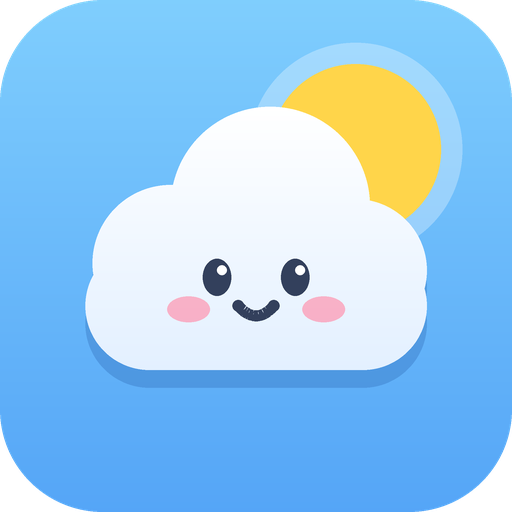
</p>

<h1 align="center">Sky Strip</h1>

<p align="center">
  An Android home screen widget that shows the next hours of weather as one colour picture.
</p>

> **Study clone.** Sky Strip is a personal learning project. It is **not affiliated with, endorsed by or
> connected to** any weather app or company. The name, icon, colours, wording and code are its own.
> Forecast data comes from [Open-Meteo.com](https://open-meteo.com).

<p align="center">
  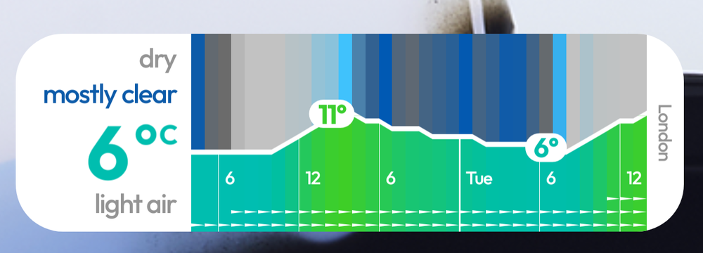
</p>

## What it does

You put the widget on your home screen and read the weather at a glance. No numbers table, no icons
to decode. The left side says what the weather is right now. The picture on the right is the forecast,
one column for every hour.

- **Sky colour** at the top: blue for clear, grey for cloudy, darker at night. The sunrise and sunset
  hours change colour partway.
- **Temperature** as a coloured area with a white line. Blue is cold, green is mild, orange and red are
  hot. The warmest and coldest points get a small bubble with the number.
- **Rain and snow** as dots hanging from the top. More dots mean more water. Blue is rain, white is snow.
- **Wind** as small arrows along the bottom. More arrows mean a higher number on the Beaufort scale.
- **Time** as thin lines and labels. Every day starts with a thicker line and the day name.

Tap the picture and the widget switches between three time ranges.

| Short | Medium | Long |
| :---: | :---: | :---: |
| Hours, about half a day | About a day and a half | About four days |

<p align="center">
  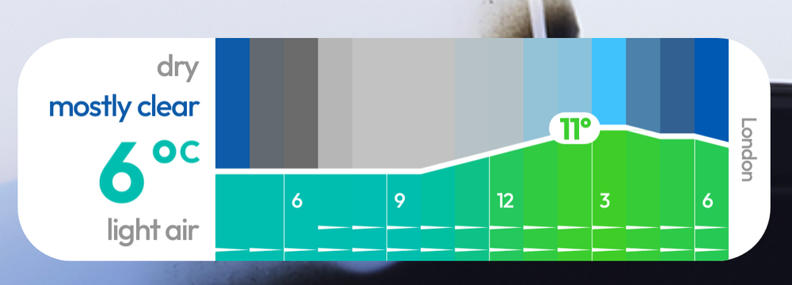
  
  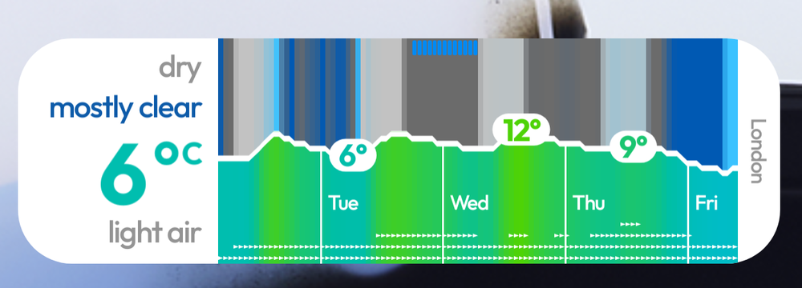
</p>

Light and dark mode follow the phone's setting.

<p align="center">
  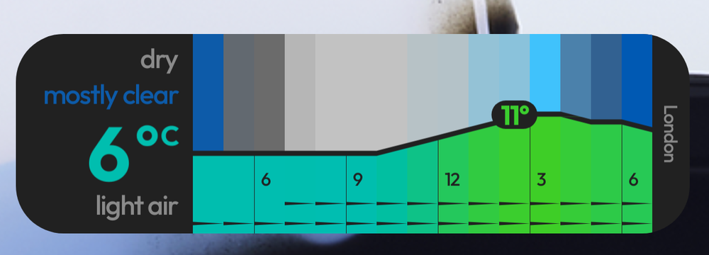
  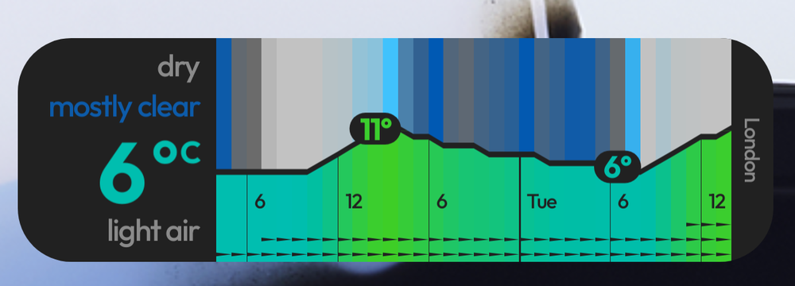
  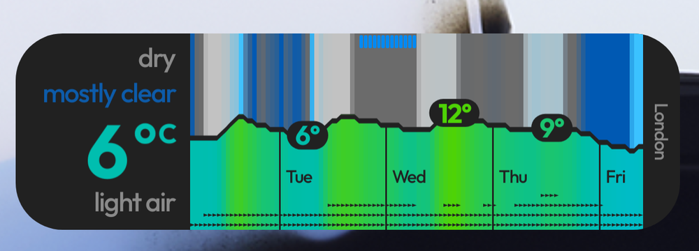
</p>

Those ranges are for a 4 by 1 widget. A wider one shows more hours, and you can shrink it to 180 dp.

## Screenshots

The app around the widget is small on purpose. There is a home screen with a quick tour, plus one settings
sheet that opens when you add a widget.

<p align="center">
  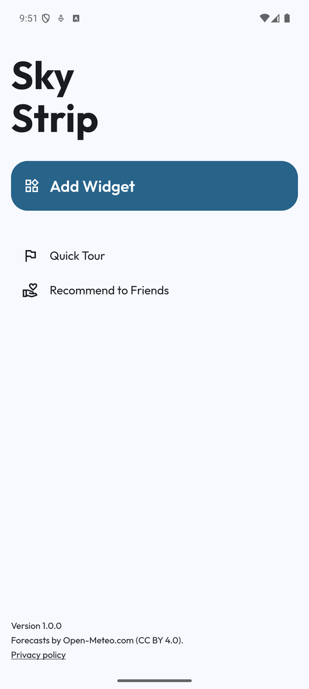
  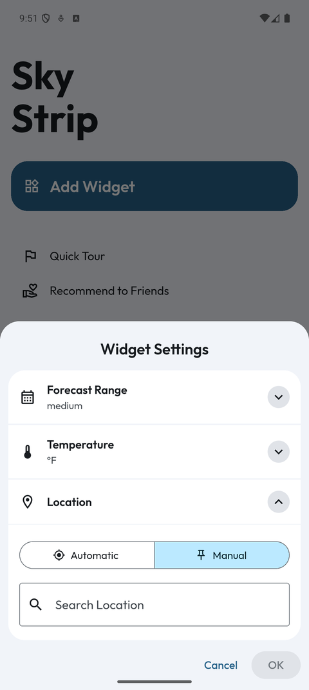
  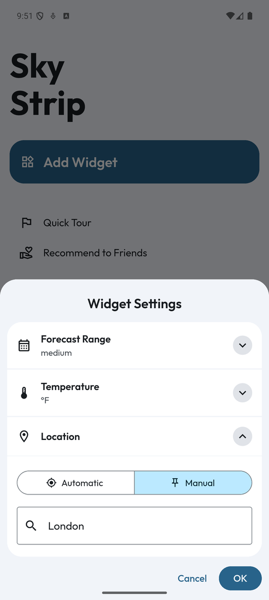
  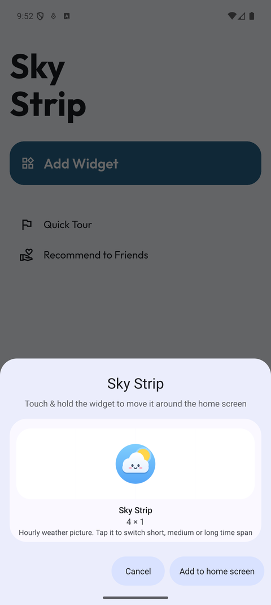
</p>

<p align="center">
  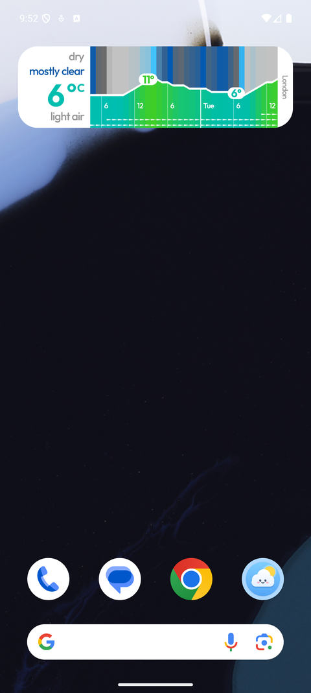
  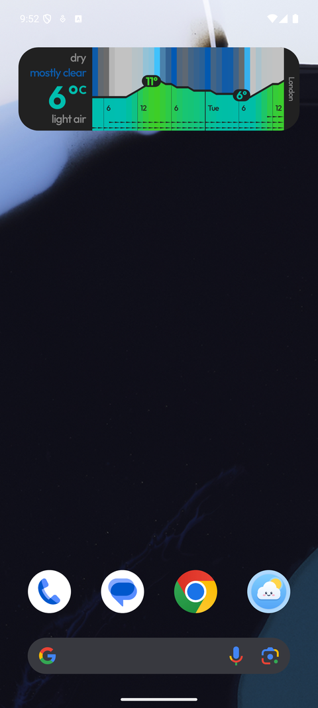
</p>

### Quick tour

The tour explains each part of the picture with a small example.

<p align="center">
  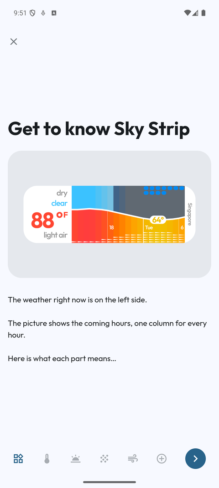
  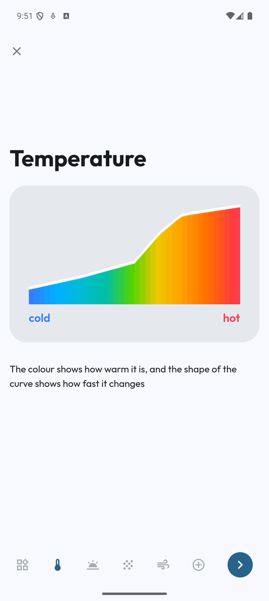
  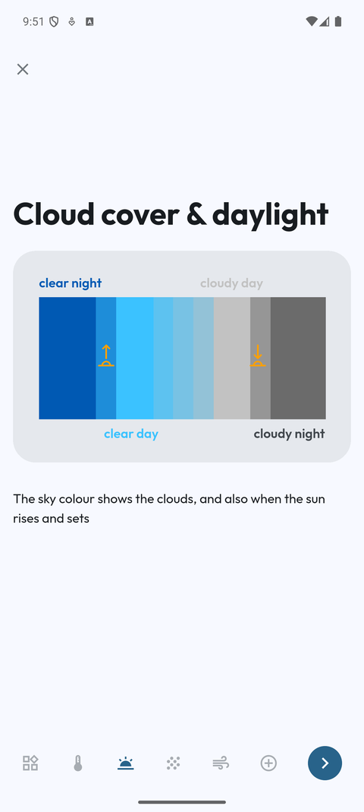
  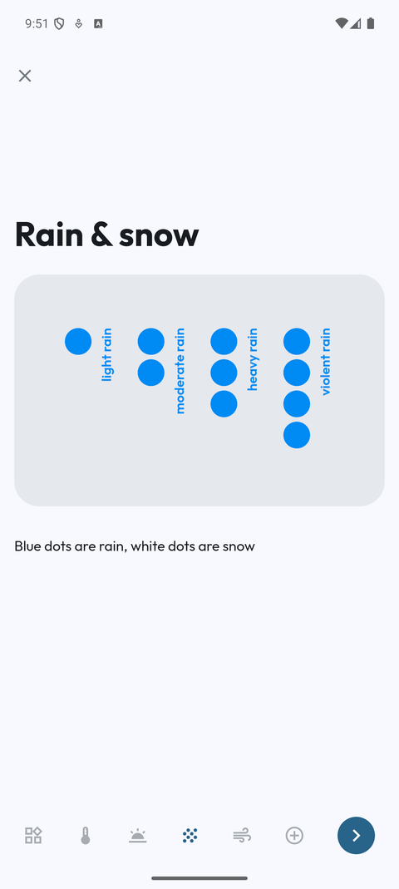
  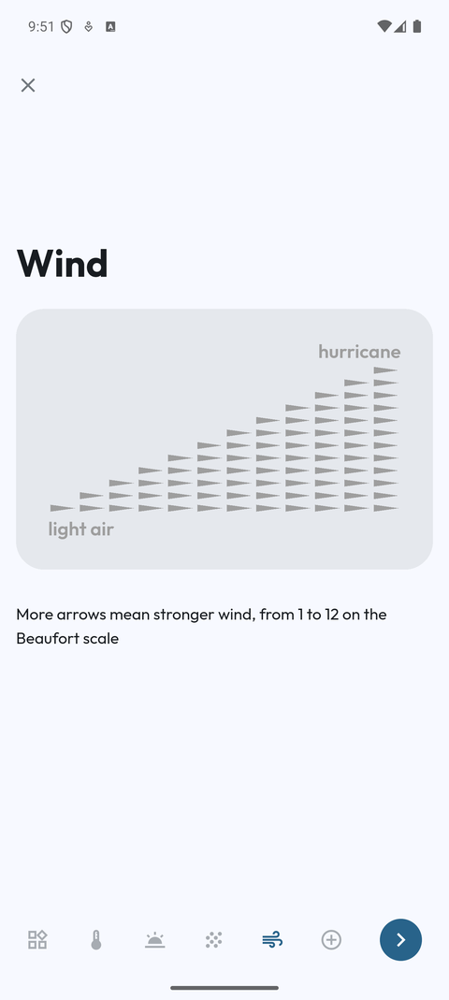
  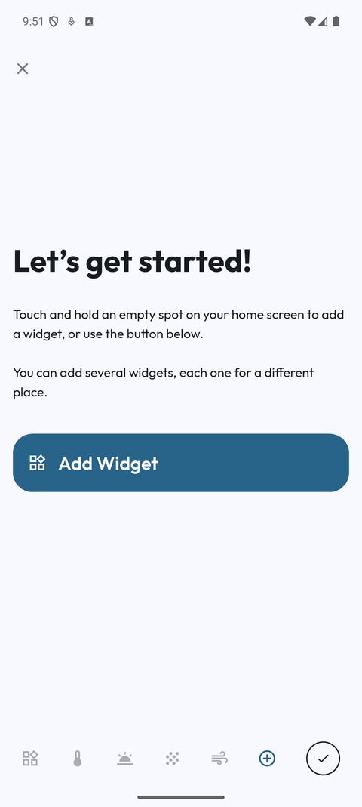
</p>

### Icon

<p align="center">
  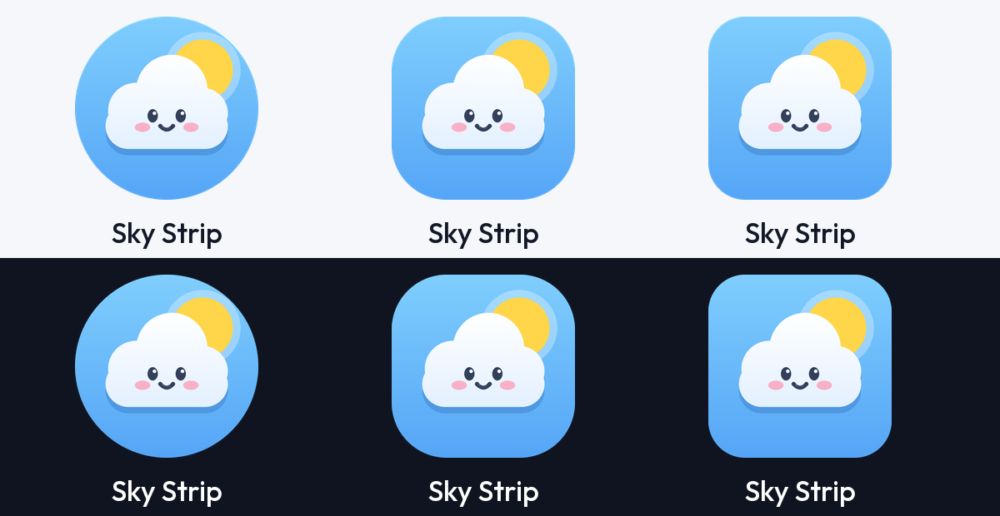
</p>

## Settings

Each widget has its own settings, so you can keep one for home and one for work.

| Setting | Choices |
| --- | --- |
| Forecast range | One of the three ranges. You can also tap the widget to switch. |
| Temperature | °C or °F. "Feels-like" and "Also show °C" are switches. |
| Location | **Automatic** follows the phone. **Manual** uses a place you search for. |

<p align="center">
  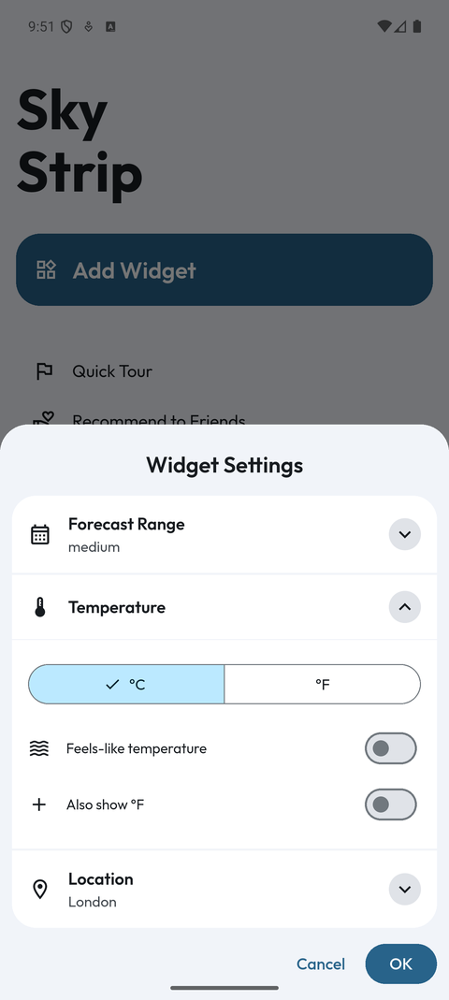
</p>

## Install

Android 7.0 (API 24) or newer.

1. Build the APK (next section) and copy `app-arm64-v8a-release.apk` to the phone.
2. Open the file and allow installs from that source when Android asks.
3. Open Sky Strip, tap **Add Widget**, pick your settings, tap **OK**, then **Add to home screen**.

Or touch and hold an empty spot on the home screen, tap **Widgets**, and find **Sky Strip**.

## Build

You need Flutter 3.47 or newer and the Android SDK.

```
cd app
flutter pub get
flutter analyze
flutter test
flutter build apk --release --split-per-abi
```

The APKs land in `app/build/app/outputs/flutter-apk/`. Phones made in the last several years need
`app-arm64-v8a-release.apk`. The release build is signed with the debug key, which is fine for your own
phone but not for a store.

The project uses compile SDK 36, Gradle 9.3.1 and the NDK version that Flutter picks by default.

## How it works

The settings app is Flutter. The widget itself is native Android code, so it keeps updating when the app
is closed.

```
app/
  lib/                      Flutter app: home, tour, settings sheet, place search
  assets/fonts/             Outfit font (open licence)
  android/app/src/main/kotlin/io/rea/weather_widget/
    MainActivity.kt         Bridge between Flutter and the widget code
    widget/
      WeatherWidgets.kt     The widget provider and the tap to switch range
      RefreshWorker.kt      WorkManager job, about every 45 minutes
      DeviceLocation.kt     Phone location without Google Play services
      Weather.kt            Open-Meteo request and parsing
      Renderer.kt           Draws the picture on a Canvas into a bitmap
      WidgetStore.kt        Per-widget settings and the saved forecast
  ios/WeatherWidgetExtension/   WidgetKit version, see Status
docs/images/                Screenshots used in this README
```

1. A background job asks Open-Meteo for the hourly forecast: temperature, feels-like, cloud cover, rain and
   snow, wind, and whether the sun is up.
2. The widget code turns each hour into one column and draws the whole picture as a bitmap sized to the
   widget.
3. On Automatic, the job first finds the phone's location. A fix younger than 20 minutes is reused, so
   the GPS is not woken for every update.
4. The Flutter app only collects settings. It has no forecast logic of its own.

Place search uses the Open-Meteo geocoding service. Neither service needs an account or a key.

## Permissions and privacy

| Permission | Why |
| --- | --- |
| Internet | Fetch the forecast and search for places. |
| Approximate and precise location | Only for **Automatic** location. |
| Location "all the time" | Only if you want Automatic to keep following you while the app is closed. |

There is no account, no ad code and no tracking. The place you type, or your phone's location on
Automatic, goes to the Open-Meteo services and nowhere else. Choose **Manual** or remove the location
permission to stop location use. The same text is on the in-app Privacy policy page.

## Status and limits

- **Android** is the supported target. It was checked on a Pixel 9 Pro XL emulator and on a Samsung phone
  running Android 17.
- **iOS** has a WidgetKit extension in `app/ios`, but it still uses an older design and has not been
  checked on a screen. Treat it as unfinished.
- Four unit tests cover settings and place search. There are no tests for the drawing code yet. It was
  checked by eye in light and dark mode on all three ranges.
- The widget picker in Android shows the app icon as a preview instead of a live picture. The real widget
  is fine once it is on the home screen.
- Colour values and layout were chosen for this project. They follow the same idea as other hourly
  weather pictures, with 5 °C colour steps, but they are not copied from any app.

## Credits and licences

- Forecasts and place search: [Open-Meteo.com](https://open-meteo.com), licensed
  [CC BY 4.0](https://creativecommons.org/licenses/by/4.0/). The free API is for non-commercial use.
- Font: [Outfit](https://fonts.google.com/specimen/Outfit), SIL Open Font License. The licence text is in
  `app/assets/fonts/Outfit-OFL.txt`.
- Icon, name, wording and screenshots: made for this project.
- No licence has been chosen for the code yet. Until one is added, all rights are reserved.
